<picture>
  <source media="(prefers-color-scheme: dark)" srcset="assets/hero-dark.svg">
  
</picture>

### Open to Opportunities

AI Engineering · Software Engineering · Founding Engineer Roles · Freelance & Consulting · Research & Development · Collaborations

Open to remote opportunities and interesting problems worth solving.

If you're building something in AI, [let's talk](mailto:nabilazehra1@gmail.com).

<a href="https://linkedin.com/in/nabilazahra17">
  <picture>
    <source media="(prefers-color-scheme: dark)" srcset="assets/btn-linkedin-dark.svg">
    
  </picture>
</a>
<a href="mailto:nabilazehra1@gmail.com">
  <picture>
    <source media="(prefers-color-scheme: dark)" srcset="assets/btn-email-dark.svg">
    
  </picture>
</a>

<em>Click to expand.</em>

🔹 <strong>More about me</strong>

 

### Impact
<picture>
  <source media="(prefers-color-scheme: dark)" srcset="assets/stats-dark.svg">
  
</picture>

### Experience
<picture>
  <source media="(prefers-color-scheme: dark)" srcset="assets/timeline-dark.svg">
  
</picture>

### Tech Stack

**AI & Agents** 

**ML** 

**Backend** 

**Cloud & DevOps** 

### Certifications

<picture>
  <source media="(prefers-color-scheme: dark)" srcset="assets/certs-dark.svg">
  
</picture>

### Beyond Work

- You'll find me Scuba diving, trekking, exploring the ocean and playing chess

