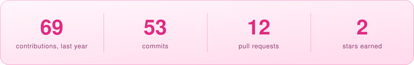

<table>
<tr>
<td width="300" align="center" valign="middle">
<picture>
  <source media="(prefers-color-scheme: dark)" srcset="assets/cat-dark.svg">
  
</picture>
</td>
<td align="left" valign="middle">

### Nabila Zahra

<em>Engineer by profession. Builder by curiosity. Founder by ambition.</em>

AI Software Engineer building production agents, multi-agent systems, RAG and LLM applications.

**Open to opportunities:** AI engineering roles · AI product roles · contract work

</td>
</tr>
</table>

If you're building something in AI, [let's talk](mailto:nabilazehra1@gmail.com).

<a href="https://linkedin.com/in/nabilazahra17">
  <picture>
    <source media="(prefers-color-scheme: dark)" srcset="assets/btn-linkedin-dark.svg">
    
  </picture>
</a>
<a href="mailto:nabilazehra1@gmail.com">
  <picture>
    <source media="(prefers-color-scheme: dark)" srcset="assets/btn-email-dark.svg">
    
  </picture>
</a>

<picture>
  <source media="(prefers-color-scheme: dark)" srcset="assets/stats-dark.svg">
  
</picture>

<strong>Flight path</strong> — experience

 
<picture>
  <source media="(prefers-color-scheme: dark)" srcset="assets/timeline-dark.svg">
  
</picture>

<strong>Gear</strong> — stack

 
<picture>
  <source media="(prefers-color-scheme: dark)" srcset="assets/constellation-dark.svg">
  
</picture>

<strong>Mission patches</strong> — certifications

 
<picture>
  <source media="(prefers-color-scheme: dark)" srcset="assets/patches-dark.svg">
  
</picture>

<strong>Off-world</strong>

 

- Scuba diving, trekking, ocean exploration, chess

<picture>
  <source media="(prefers-color-scheme: dark)" srcset="assets/stats-card-dark.svg">
  
</picture>

