<picture>
  <source media="(prefers-color-scheme: dark)" srcset="assets/hero-dark.svg">
  
</picture>

<em>Engineer by profession. Builder by curiosity. Founder by ambition.</em>

AI Engineer building production systems at the frontier of intelligent software.

Working with autonomous agents, multi-agent systems, LLM architectures, RAG, and distributed applications.

Driven by curiosity, systems thinking, and the challenge of making emerging technology genuinely useful.

### Connect

<a href="https://linkedin.com/in/nabilazahraa">
  <picture>
    <source media="(prefers-color-scheme: dark)" srcset="assets/btn-linkedin-dark.svg">
    
  </picture>
</a>
<a href="mailto:nabilazehra1@gmail.com">
  <picture>
    <source media="(prefers-color-scheme: dark)" srcset="assets/btn-email-dark.svg">
    
  </picture>
</a>

### Engineering impact

<picture>
  <source media="(prefers-color-scheme: dark)" srcset="assets/stats-dark.svg">
  
</picture>

## Flight path

<picture>
  <source media="(prefers-color-scheme: dark)" srcset="assets/timeline-dark.svg">
  
</picture>

## Planet collection

<table>
<tr>
<td width="50%">
<picture>
  <source media="(prefers-color-scheme: dark)" srcset="assets/project-restaurant-dark.svg">
  
</picture>

<a href="YOUR_REPO_URL">Repository →</a>

</td>
<td width="50%">
<picture>
  <source media="(prefers-color-scheme: dark)" srcset="assets/project-medical-dark.svg">
  
</picture>

<a href="YOUR_REPO_URL">Repository →</a>

</td>
</tr>
<tr>
<td width="50%">
<picture>
  <source media="(prefers-color-scheme: dark)" srcset="assets/project-rahguzar-dark.svg">
  
</picture>

<a href="https://github.com/nabilazahraa/Rahguzar-Optimize-Field-Sales-Routes">Repository →</a>

</td>
<td width="50%">
<picture>
  <source media="(prefers-color-scheme: dark)" srcset="assets/project-portfolio-opt-dark.svg">
  
</picture>

<a href="YOUR_REPO_URL">Repository →</a>

</td>
</tr>
</table>

## Gear: constellation map

<picture>
  <source media="(prefers-color-scheme: dark)" srcset="assets/constellation-dark.svg">
  
</picture>

**AI and LLM stack**

## Mission patches

<picture>
  <source media="(prefers-color-scheme: dark)" srcset="assets/patches-dark.svg">
  
</picture>

<strong>Off-world</strong>

 

- 🤿 Scuba diving
- 🥾 Trekking and mountaineering
- 🐋 Ocean exploration
- ♟️ Chess

<strong>Education</strong>

 

- **Habib University** — BS Computer Science, 2025, GPA 3.68
- **Stanford University** — International Honors Program, 2023

## Contribution galaxy

<picture>
  <source media="(prefers-color-scheme: dark)" srcset="https://raw.githubusercontent.com/nabilazahraa/nabilazahraa/output/github-snake-dark.svg">
  
</picture>

<picture>
  <source media="(prefers-color-scheme: dark)" srcset="assets/footer-dark.svg">
  
</picture>

